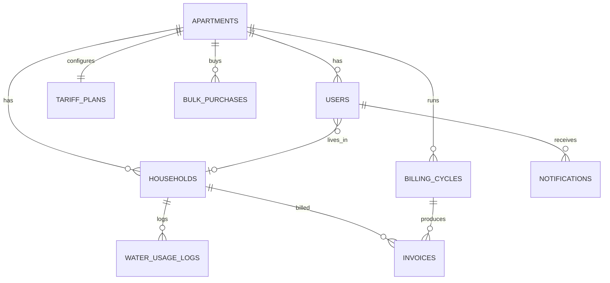

# AquaTrack - Smart Water Usage Monitoring & Automated Billing Platform
Live: https://smartwater-frontend.onrender.com
Full-stack apartment water platform: **Spring Boot 3 (Java 17) + PostgreSQL + React 18 (Vite, Recharts)**.

| Module (project brief) | Where it lives |
|---|---|
| Schema, auth, usage logging, core REST APIs | `db/migration/V1__init_schema.sql`, `domain/`, `security/`, `AuthService`, `HouseholdService`, `UsageService` |
| Billing engine, distribution, alerts | `billing/BillingCalc`, `BillingService`, `AlertService` (`@Scheduled`), `EmailService` |
| Resident dashboard, admin panel, PDF invoices | `frontend/src/pages/**`, `PdfService` (Apache PDFBox) |
| Integration, testing, docs | `src/test/**`, `load-test/k6-script.js`, Swagger UI, `docker-compose.yml` |

## Quick start (Docker)
```bash
docker compose up --build
```
| Service | URL |
|---|---|
| Web app | http://localhost:3000 |
| Swagger / OpenAPI | http://localhost:8080/swagger-ui.html |
| Email inbox (MailHog) | http://localhost:8025 |

Demo data is seeded on first start (`SEED_DEMO=true`): apartment code **GREEN1**, 12 units (last one unmetered), 75 days of readings, a finalized previous cycle, an open current cycle and a simulated leak in A-102.

| Role | Login |
|---|---|
| Admin | `admin@demo.com` / `Admin@123` |
| Resident (A-101) | `resident1@demo.com` / `Resident@123` (also resident2-4) |

Set `SEED_DEMO=false` and a strong `JWT_SECRET` for anything real.

## Run locally without Docker
```bash
# 1. PostgreSQL + MailHog (or any SMTP)
docker compose up db mailhog
# 2. Backend (Java 17, Maven)
cd backend && mvn spring-boot:run
# 3. Frontend (Node 18+)
cd frontend && npm install && npm run dev      # http://localhost:5173 (proxies /api -> :8080)
```

## How billing works
For a billing cycle (start-end dates) the engine computes, per household:

1. **Metered kL** = sum of daily litres in the cycle / 1000.
2. **Shared-area cost** = cycle's shared kL (garden/pool/lobby) x weighted-average purchase cost per kL (from bulk purchases dated inside the cycle; falls back to the tier-1 rate if none), split **by flat area or by occupancy** (tariff setting).
3. **Water charge**, depending on the tariff's billing mode:
   * `TIERED` - first *N* kL at the base rate, the rest at the higher rate, plus an optional fixed charge.
   * `COST_SHARING` - (total bulk purchase cost - shared-area cost) split **proportionally to consumption**; unmetered households fall back to a **flat-area basis** (estimated at the metered average kL per sq ft).
4. Invoice total = water charge + shared allocation + admin adjustment. Splits are rounded to 2 dp with the remainder assigned to the largest share so parts always sum exactly.

Lifecycle: `OPEN` (live preview, nothing stored) -> `FINALIZED` (invoices generated, residents notified by email + in-app) -> `ARCHIVED`.

## Alerts
`AlertService` runs daily (`ALERT_CRON`, default 07:00) and on demand (admin -> *Run checks now*, and after CSV imports):
* **Overuse** - month-to-date usage above the apartment's threshold -> resident email + in-app notification (once per month).
* **Leak / anomaly** - latest reading > mean + 2 sigma of the household's previous ~30 days (needs >= 7 days of history) -> resident alert + admin report email.

## API overview (full reference in Swagger UI)
| Area | Endpoints |
|---|---|
| Auth | `POST /api/auth/register-admin`, `/register`, `/login`; `GET/PUT /api/auth/me` |
| Households (admin) | `GET/POST /api/admin/households`, `PUT/DELETE /{id}`, `POST /{id}/assign` |
| Usage | `POST /api/usage` (manual), `GET /api/usage?from&to`, `POST /api/admin/usage/upload` (CSV), `GET /api/admin/usage/comparison` |
| Tariff & purchases (admin) | `GET/PUT /api/admin/tariff`, `GET/POST/DELETE /api/admin/purchases` |
| Billing (admin) | `GET/POST /api/admin/cycles`, `POST /{id}/finalize`, `/{id}/archive`, `GET /{id}/invoices`, `PUT /api/admin/invoices/{id}/adjustment`, `/paid`, `POST /api/admin/alerts/run` |
| Resident | `GET /api/dashboard`, `/dashboard/compare`, `/invoices`, `/invoices/{id}/pdf`, `/notifications` |

CSV format: `unit_number,date,litres` (ISO date). Invalid rows are reported; duplicates (same unit + date) are skipped.

## Data model


## Tests
```bash
cd backend && mvn test
```
* `BillingCalcTest` - tiers, proportional split, rounding, unmetered fallback, anomaly rule.
* `AuthServiceTest` - Mockito unit tests.
* `ApiIntegrationTest` - `@SpringBootTest` + MockMvc (H2): register -> households -> usage (duplicate = 409) -> CSV -> purchase -> cycle preview -> finalize -> PDF -> resident dashboard, plus 401/403 checks.
* Load test: `k6 run load-test/k6-script.js`.

## Configuration (env vars)
`DB_URL DB_USER DB_PASSWORD JWT_SECRET MAIL_HOST MAIL_PORT MAIL_USER MAIL_PASSWORD MAIL_AUTH MAIL_TLS MAIL_ENABLED MAIL_FROM ALERT_CRON SEED_DEMO CORS_ORIGINS PAYMENT_INSTRUCTIONS`.
For SendGrid use `MAIL_HOST=smtp.sendgrid.net MAIL_PORT=587 MAIL_USER=apikey MAIL_PASSWORD=<key> MAIL_AUTH=true MAIL_TLS=true`.

## Known limitations
* Currency is shown as INR (₹); PDFs print "INR" because the built-in PDF fonts lack the rupee glyph.
* A household's readings are daily litres (not cumulative meter dial values).
* Households must be registered by the admin before residents can sign up with the apartment code.
* Cycles may not overlap; the shared-area kL for a cycle is entered by the admin.
* JWTs are stateless (no refresh/revocation); tokens expire after 12 h.
